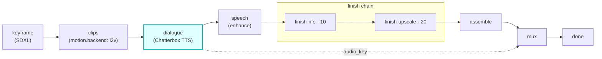

# chatterbox

A first-class **`dialogue`**-hook module (vivijure-module/2). It voices each speaking shot's line with
the RunPod public **`chatterbox-turbo`** endpoint, in the cast member's assigned voice, and writes one WAV per shot
to the shared render bucket.

This is the **dialogue (TTS) stage**, the audio source for the talking-characters pipeline. The whole
film is one submit+poll: the core sends every speaking shot in ONE batch, not N module round-trips.

## Where it fits

The seam is the audio key: this module produces `job.dialogue_audio[shot]`, the **speech** chain cleans
it, and the cleaned key becomes the shot's spoken track in the final mux. A shot with no spoken line
simply has no audio key.

It used to flow into `finish-lipsync` (MuseTalk) to drive the mouth. MuseTalk is ruled out
permanently and that module is removed (cf#783), so the mouth is no longer patched after the fact:
a synced mouth comes from a driving-audio motion door (`infinitetalk`) at motion time, and submit
refuses a spoken line on a silent door. Note the phase
order: `dialogue` runs AFTER clips, so this module's audio was never what fed that door.

## Configuration

Config options: **none**. There are no user-facing knobs; the voice is the speaking cast member's
assigned `voice_id` (resolved by the core) and the line is the shot's dialogue, both authored upstream
(cast + script), not module config.

To self-host (service `vivijure-module-chatterbox`, bound into the core as `MODULE_DIALOGUE`):

- **Env at deploy**: `CLOUDFLARE_ACCOUNT_ID` (account_id is injected, never hardcoded).
- **Bindings** (in `wrangler.toml`): `R2_RENDERS` -> R2 bucket
  `vivijure` (per-shot WAVs + run state), and `CHATTERBOX_WORKFLOW` -> the `ChatterboxWorkflow` class
  (one `step.do` per shot).
- **Secret**: `RUNPOD_API_KEY` (Secrets Store), or `RUNPOD_PROXY_BASE` + `RUNPOD_PROXY_TOKEN` for a
  proxied route. The `AI` and `GATEWAY_ID` bindings in `wrangler.toml` are left from the Aura-1 era
  and this code does not read them.
- **Provision**: a RunPod account. The model is the public `chatterbox-turbo` endpoint; no endpoint of
  your own is needed.

## Contract

- **Hook**: `dialogue` (one producer; per-film batch). `ui { section: "dialogue", order: 10 }`.
- **Input** (`DialogueInput`): `project` (the R2 key prefix) + `lines[]`, each `shot_id`, `text`, and
  optional `voice_id` (the cast member's catalog voice, mapped to a Chatterbox voice; absent/unknown falls
  back at synth time).
- **Output** (`DialogueOutput`): `project`, `audio[]` (`shot_id`, `audio_key`, the `voice_id` actually
  used post-fallback), and `applied`.
- **Async**: each line is one `/runsync` job inside a Cloudflare **Workflow** (unlimited wall,
  per-step checkpoint, survives a recycle), since a request-path `waitUntil` is cancelled at ~30s
  (#155). A job still `IN_QUEUE` or `IN_PROGRESS` when `/runsync` returns is polled by its id
  (`/status/<id>`, 20 s apart, at most 30 polls), never submitted again. A job that outlasts that is
  cancelled (`/cancel/<id>`), and the film fails with the job id, the status it was stuck in, and the
  provider's own error (cf#1164). `POST /invoke` starts the workflow and returns a poll token; `POST
  /poll` reads R2 run state, authoritative for done.
- **R2 transport**: per-shot WAVs and run state land in the shared `vivijure` bucket.

This is a producer stage: a real failure is an honest `ok:false`, not a fake-success tag.

## License

**AGPL-3.0-only.** A labor of love, given freely: use it, learn from it, self-host it, build your own creative visions on it. Run it as a network service and the AGPL has you share your changes back, so it stays a commons. It is not for sale, and not to be resold as a SaaS.
